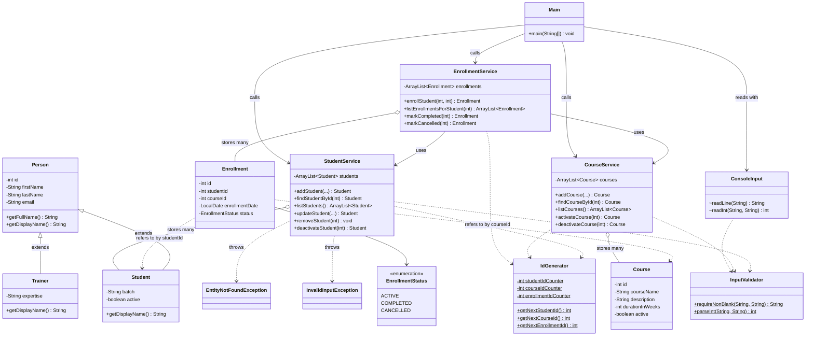

# LearnTrack: Student & Course Management System

LearnTrack is a console-based application, written in plain Core Java, for managing **students**, **courses** and **enrollments**. It is menu-driven, keeps all data in memory (no database or files), and is built to practise Java fundamentals: packages, classes and objects, constructors, encapsulation, inheritance, static members, `ArrayList` and basic exception handling.

## Features

| Menu | What you can do |
|---|---|
| **Student Management** | Add a student (email optional), view all, search by ID, update, deactivate / reactivate |
| **Course Management** | Add a course (description optional), view all, activate / deactivate |
| **Enrollment Management** | Enroll a student in a course, view a student's enrollments, mark an enrollment completed or cancelled, view all enrollments |

Rules the services enforce (each breach shows a clear message instead of crashing):

- Names, batch and course name must not be empty; duration must be a positive whole number.
- An email, when given, must look like `name@domain.tld` and be unique among students.
- Course names must be unique (case-insensitive).
- Students are deactivated, never deleted. Inactive students and inactive courses cannot be used in new enrollments.
- A student cannot have two `ACTIVE` enrollments in the same course.
- Only an `ACTIVE` enrollment can be marked `COMPLETED` or `CANCELLED`.
- Unknown IDs, non-numeric input and unknown menu options are reported, and the program carries on.

## Requirements

- JDK 17 recommended (built and tested with OpenJDK 17.0.9; see [docs/Setup_Instructions.md](docs/Setup_Instructions.md)). The code only uses Java 8 language features and compiles with `--release 8`, but it has only been run on 17.
- No libraries, no build tool

## How to compile and run

Run these from the project root (the folder that contains `src`). They compile every `.java` file into an `out` folder and start the app.

**PowerShell (Windows)**

```powershell
javac -d out (Get-ChildItem -Recurse src -Filter *.java).FullName
java -cp out com.airtribe.learntrack.ui.Main
```

**Command Prompt (Windows)**

```bat
dir /s /b src\*.java > sources.txt
javac -d out @sources.txt
java -cp out com.airtribe.learntrack.ui.Main
```

**Bash (macOS / Linux / Git Bash)**

```bash
javac -d out $(find src -name "*.java")
java -cp out com.airtribe.learntrack.ui.Main
```

**IDE (IntelliJ IDEA / Eclipse / VS Code):** open this folder, mark `src` as the sources root, and run `com.airtribe.learntrack.ui.Main`.

At any menu, type the number of an option and press Enter. Choose `0` to go back or exit.

### Example session

Menu blocks are left out below; `<-` notes are not part of the program output.

```text
=== LearnTrack: Student & Course Management ===
Choose an option: 1                          <- Student Management
Choose an option: 1                          <- Add new student
First name: Ada
Last name: Lovelace
Email (press Enter to skip): ada@example.com
Batch: B1
Student added: [ID 1] Ada Lovelace (Batch B1) | ada@example.com | ACTIVE
Choose an option: 0                          <- back to main menu
Choose an option: 2                          <- Course Management
Choose an option: 1                          <- Add new course
Course name: Java Basics
Description (press Enter to skip): Intro to Java
Duration in weeks: six
Error: Duration must be a whole number, but you entered 'six'.
Choose an option: 1
Course name: Java Basics
Description (press Enter to skip): Intro to Java
Duration in weeks: 6
Course added: [ID 1] Java Basics | 6 weeks | ACTIVE | Intro to Java
Choose an option: 0
Choose an option: 3                          <- Enrollment Management
Choose an option: 1                          <- Enroll a student in a course
Student ID: 1
Course ID: 1
Enrolled: [Enrollment 1] Student 1 -> Course 1 | 2026-10-11 | ACTIVE
Choose an option: 1
Student ID: 1
Course ID: 1
Error: Student 1 is already enrolled in course 1.
Choose an option: 2                          <- View enrollments for a student
Student ID: 1
Enrollments for Ada Lovelace (Batch B1):
  [Enrollment 1] Java Basics | 2026-10-11 | ACTIVE
```

## Project structure

```text
Java_Crashcourse/
├── README.md
├── docs/
│   ├── Setup_Instructions.md     JDK version and "Hello World" run
│   ├── JVM_Basics.md             JDK vs JRE vs JVM, bytecode, write once run anywhere
│   └── Design_Notes.md           why ArrayList, where static is used, where inheritance is used
└── src/com/airtribe/learntrack/
    ├── entity/       Person, Student, Trainer, Course, Enrollment, EnrollmentStatus
    ├── service/      StudentService, CourseService, EnrollmentService
    ├── ui/           Main (menus), ConsoleInput (package-private input helper)
    ├── exception/    EntityNotFoundException, InvalidInputException
    └── util/         IdGenerator, InputValidator
```

## Class diagram

The diagram is written in [Mermaid](https://mermaid.js.org/). GitHub draws it automatically; in other editors you may need a Markdown preview with Mermaid support.



In short:

- `Student` and `Trainer` **inherit** from `Person`.
- An `Enrollment` links a student to a course **by ID**, so it never holds a `Student` or `Course` object directly.
- Each service **owns** an `ArrayList` of its entities; `EnrollmentService` **uses** the other two services to check that students and courses exist.
- `Main` only talks to the services and `ConsoleInput`. It contains no business rules.

## Where each requirement is demonstrated

| Topic | Where to look |
|---|---|
| Packages, access levels | all sub-packages; `ConsoleInput` is package-private, fields are `private` |
| Encapsulation, constructors | `entity/*` (private fields, getters/setters) |
| Constructor overloading | `Student` (with / without email), `Enrollment`, `EntityNotFoundException` |
| Inheritance, `super`, overriding | `Person` -> `Student`, `Trainer` (`getDisplayName()`) |
| Polymorphism | `Person.toString()` calls `getDisplayName()`; the subclass version runs |
| Static members | `IdGenerator` counters and methods, `InputValidator`, `Main.main` |
| Method overloading | `addStudent`, `addCourse`, `listStudents`, `listCourses` |
| `ArrayList` | the three services |
| Control flow | `while` menu loops with `switch` in `Main`; `for` loops in the services |
| Exception handling | custom exceptions; `try`-`catch` in `InputValidator.parseInt` and in the menu loops |

More detail on the design choices is in [docs/Design_Notes.md](docs/Design_Notes.md).
